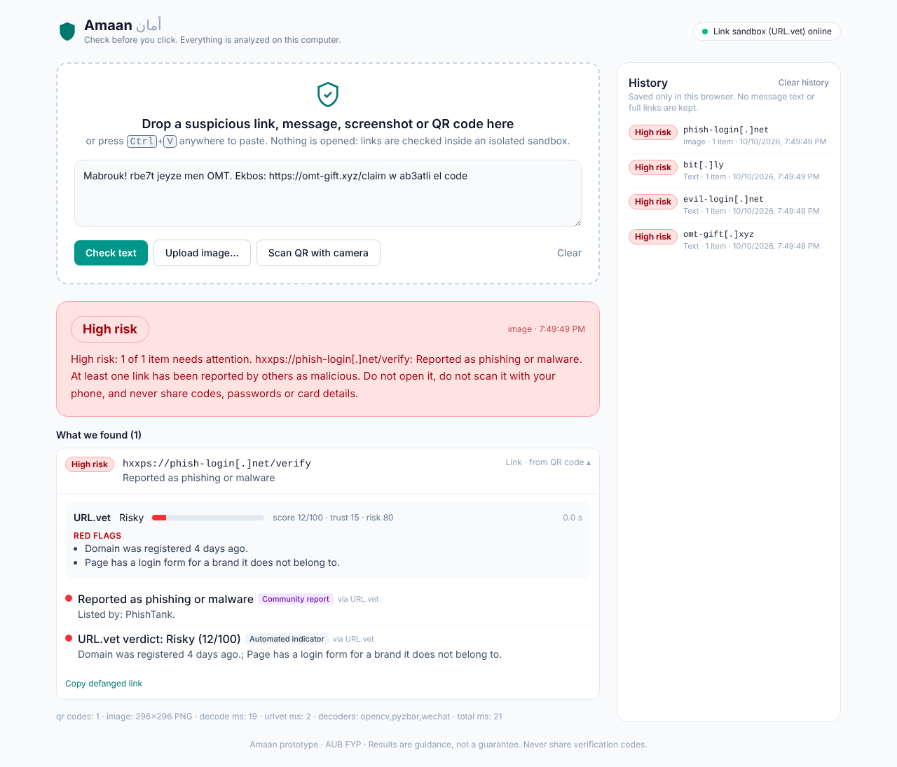

# Amaan (أمان): scam checker for Lebanese users

AUB final-year project prototype. Drop or paste something suspicious (a link,
a message, a screenshot with a QR code) or point your webcam at a QR code. You
get a **Low / Medium / High** verdict that shows its evidence: which checks
fired, why, and whether each one is an *automated indicator*, a *community
report* or *verified*.



**Safety by design**
- Amaan never opens a link. Links are checked by [URL.vet](https://github.com/urlvet/urlvet)
  inside its own containers (headless Chrome in Docker), and short links are
  followed there too.
- Message text, images and history never leave your computer. Only a link
  you ask to check is contacted by URL.vet (see `docs/DECISIONS.md`, D2).
- Uploads are processed in memory and deleted after analysis, and logs never
  contain links or messages.
- Everything listens on `127.0.0.1` only.

## Status

| Milestone | What | State |
|---|---|---|
| 1 | Link + QR detection end to end (drop, paste, upload, **webcam**) | ✅ done |
| 2 | Lebanese voice-note transcription (Whisper) | next |
| 3 | WhatsApp feasibility + Baileys demo + chat-export import | planned |

**Guides:** [Testing](docs/TESTING.md) · [Demo video plan](docs/DEMO.md) ·
[Demo samples](demo/README.md) · [Contributing](CONTRIBUTING.md) ·
[Decisions](docs/DECISIONS.md)

---

## Windows setup (first time, ~20 minutes)

1. **Install WSL2.** In an *admin* PowerShell: `wsl --install`, then reboot.
2. **Install Docker Desktop** (https://www.docker.com/products/docker-desktop/).
   In Settings → General, keep *Use the WSL 2 based engine* ticked. Docker
   Desktop must be running (whale icon in the tray).
3. **Install Git for Windows** (https://git-scm.com/download/win).
4. Clone and start:
   ```powershell
   git clone https://github.com/maherbekdache/maherbekdache.git amaan
   cd amaan
   # Allow local scripts for this window only:
   Set-ExecutionPolicy -Scope Process -ExecutionPolicy Bypass
   .\scripts\amaan.ps1 up
   ```
   The first run downloads and builds URL.vet and Amaan (5-15 minutes). It
   then opens **http://localhost:8000**.

Day to day:

```powershell
.\scripts\amaan.ps1 up          # start everything (add -UrlvetUi for URL.vet's own UI on :3000)
.\scripts\amaan.ps1 status      # what is running + health
.\scripts\amaan.ps1 logs        # Amaan logs
.\scripts\amaan.ps1 down        # stop everything
.\scripts\amaan.ps1 test        # automated checks (pytest + type check)
.\scripts\amaan.ps1 dev         # hot-reload dev servers on http://localhost:5173
.\scripts\amaan.ps1 dev -Mock   # no Docker: FAKE URL.vet, never for the demo
```

From WSL, Linux or macOS use `./scripts/amaan.sh` with the same commands.

What the script does: it clones URL.vet at a pinned commit into
`third_party/urlvet` (git-ignored, unmodified, AGPL-3.0) and generates its
`.env` files with random secrets. It creates the `amaan-urlvet` Docker
network, starts URL.vet (`backend`, `chrome`, `valkey`) bound to localhost,
then builds and starts Amaan from `docker-compose.yml`.

### Troubleshooting
- **"Docker Desktop is not running"**: start it and wait until it says *Engine running*.
- **Ports 8000 / 8080 already in use**: stop the other program, or run `.\scripts\amaan.ps1 down`.
- **Pill in the top-right says "URL.vet offline"**: `docker compose -p urlvet ps`. The first
  start can take a minute while URL.vet loads its lists. Links are still checked with Amaan's
  local rules meanwhile and marked *incomplete*.
- **Camera does not start**: use `http://localhost:8000`. Browsers only allow the camera
  on localhost or HTTPS. Allow the permission prompt; close other apps using the webcam.
- **Docker Hub "429 Too Many Requests"** while building: wait a few minutes or `docker login`.

---

## Developing (hot reload, no Docker for Amaan itself)

Keep URL.vet running in Docker (`.\scripts\amaan.ps1 up` once, then
`docker compose stop amaan`), and run Amaan's backend and frontend natively.

```powershell
# Backend: Python 3.11
cd backend
py -3.11 -m venv .venv
.venv\Scripts\pip install -e ".[dev]"
.venv\Scripts\uvicorn amaan.main:app --reload --host 127.0.0.1 --port 8000
```
```powershell
# Frontend: Node 20+
cd frontend
npm install
npm run dev        # http://localhost:5173 (proxies /analyze and /health to :8000)
```

On Windows, `pyzbar` ships its own zbar DLL. If it fails to load, install the
[Visual C++ 2013 runtime](https://www.microsoft.com/en-us/download/details.aspx?id=40784).
QR decoding still works without it (OpenCV + WeChat detectors).

**Tests**

```powershell
cd backend
.venv\Scripts\python -m pytest            # URL extraction, QR decoding, mocked URL.vet, scoring, API
cd ..\frontend
npm run typecheck
```

## Configuration

Environment variables (or `backend/.env`), all prefixed `AMAAN_`:

| Variable | Default | Meaning |
|---|---|---|
| `AMAAN_URLVET_BASE_URL` | `http://localhost:8080` (Docker: `http://urlvet-backend:8080`) | URL.vet API |
| `AMAAN_URLVET_TIMEOUT_S` | `25` | URL.vet scans take 1-15 s |
| `AMAAN_MAX_URLS_PER_REQUEST` | `10` | URL.vet allows 20 checks/minute |
| `AMAAN_MAX_UPLOAD_BYTES` | `10485760` | 10 MB |
| `AMAAN_MAX_IMAGE_PIXELS` | `40000000` | decompression-bomb guard |
| `AMAAN_WECHAT_MODEL_DIR` | *(none)* | optional WeChat QR CNN models for hard photos |

## API

| Endpoint | Body | Notes |
|---|---|---|
| `GET /health` | | backend version, URL.vet reachability, QR decoders available |
| `POST /analyze/text` | JSON `{text, html?, uri_list?}` | the three drag-and-drop flavours; HTML is parsed, never rendered |
| `POST /analyze/image` | multipart `file` (+ `source=camera`) | PNG / JPG / WebP, several QR codes per image |

Each analyze endpoint returns the same **Evidence** object: `input_type`, `items[]`
(each with `kind`, `display` (defanged), `urlvet` verdict/score/reasons/redirect chain,
`signals[]` with `label` + `source`, `risk_level`), message-level `signals[]`, overall
`risk_level`, `complete`, plain-English `explanation`, `warnings`, `stats`.
Interactive docs: http://localhost:8000/api/docs.

## Repository layout

```
backend/            FastAPI app (amaan/) + pytest suite (tests/)
  amaan/extract/    URL extraction, QR decoding, payload types, HTML parsing (all offline)
  amaan/clients/    URL.vet HTTP client
  amaan/scoring/    local rules, Arabic/Arabizi cues, risk aggregation + explanation
  amaan/data/       curated official domains (team must verify) + URL shorteners
frontend/           React + Vite + TypeScript + Tailwind single-page UI
infra/urlvet/       config-only overlay + env template for URL.vet
scripts/            amaan.ps1 (Windows) / amaan.sh (WSL, Linux, macOS)
docs/               DECISIONS.md, LINK_TOOLS_COMPARISON.md, screenshots
third_party/        (git-ignored) URL.vet clone, created by the scripts
```

## Licences
Our code: to be chosen by the team. URL.vet: AGPL-3.0, used as a separate,
unmodified service over HTTP. Python/JS dependencies: permissive
(MIT/BSD/Apache, OpenCV Apache-2.0, jsQR Apache-2.0). See
`docs/LINK_TOOLS_COMPARISON.md` for Lookyloo (BSD-3) and PhishIntention (CC0)
as possible additions.
